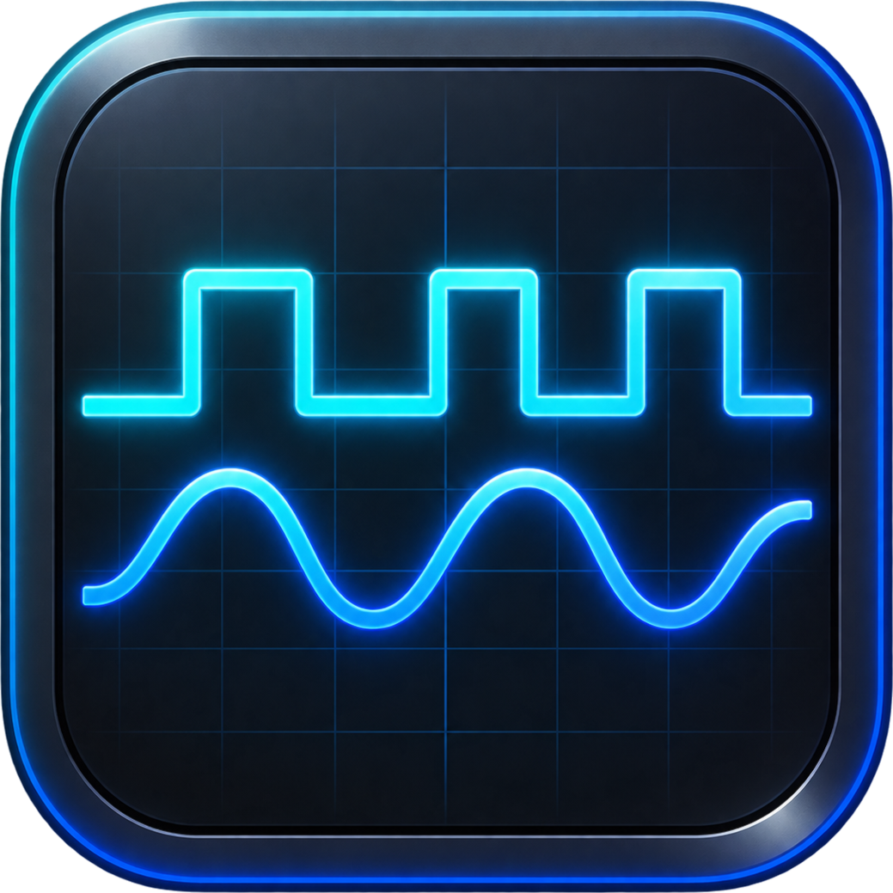

<p align="center">
  
</p>

# LogicView

LogicView is an open-source project for capturing and exploring signals and building an extensible platform for laboratory hardware. It aims to bring USB- and Ethernet-connected devices into a consistent workspace, from logic analyzers to rack instruments controlled using SCPI. Current hardware work focuses on DSLogic logic analyzers; broader device and instrument support is a future goal.

LogicView is an independent project and is not affiliated with DreamSourceLab.

## Project status

LogicView is in early development. The Rust workspace includes a desktop waveform interface, a capture engine, simulated devices, protocol decoders, and a Model Context Protocol (MCP) server. You can explore the interface with the demo devices without connecting hardware.

- **Hardware:** Buffer and stream captures have been checked on one DSLogic Plus (`0x2A0E:0x0020`) and one DSLogic U3Pro32 (`0x2A0E:0x002C`). Other listed DSLogic models cannot currently be opened and have not been tested. Simultaneous arming of two USB pods has not been verified.
- **Analysis:** Waveform measurements and UART, I2C, SPI, and 24xx-style EEPROM decoding are available. The interface includes a data table and an ordered edge-trigger interface; hardware trigger stages have not been verified on a pod.
- **Platforms:** Windows and Linux desktop builds are the current focus. macOS, Android, and iOS are goals for future investigation, not supported releases. Mobile support depends on platform and hardware-access constraints.
- **Scope:** SCPI instruments, Ethernet-connected devices, oscilloscopes, and data acquisition are not supported in the current build.

See [Mission and vision](MISSION.md) for the project's direction and [Contributing](CONTRIBUTING.md) for ways to help.

## Get started

Install the stable [Rust toolchain](https://www.rust-lang.org/tools/install). On Linux, the desktop build also requires WebKitGTK 4.1, GTK 3, and pkg-config development packages. On Windows, the desktop window uses WebView2.

```sh
cargo test --workspace
cargo run -p logicview-app
```

The app opens a desktop window and serves its interface on loopback port `4173`. Set `LOGICVIEW_PORT` to choose a different port. Press **Run** to use the demo source; add **Demo SPI** from the device drawer to see multiple demo pods on the waveform. The analyzers drawer adds protocol decoders, and the measurement drawer keeps waveform readings.

For supported hardware, firmware and FPGA bitstreams are not included in the repository. If the pod's FPGA is not already configured, set `LOGICVIEW_FIRMWARE_DIR` to a directory containing the appropriate user-supplied `DSLogicPlus.bin` or `DSLogicU3Pro32.bin`. See [Contributing](CONTRIBUTING.md) before working with hardware or reference materials.

### Windows packaging

From the repository directory:

```bat
scripts\package-release.cmd
scripts\run-debug.cmd
```

The packaging script builds a release executable and writes `dist\logicview-<version>-windows.zip`, including the UI assets. Extract the archive and run `logicview.exe`. The debug script keeps a console open for logs.

### MCP server

```sh
cargo run -p logicview-app -- mcp
```

The stdio MCP server attaches to a running engine when available; otherwise it starts its own demo engine. On Unix the default endpoint is `/tmp/logicview.sock`. On Windows, the running UI writes its loopback TCP endpoint to `%TEMP%\logicview.sock`. `LOGICVIEW_SOCKET` overrides the Unix socket path or Windows endpoint file path; on Windows a loopback `host:port` value specifies a TCP address instead.

## Architecture

| Crate | Responsibility |
| --- | --- |
| `logicview-proto` | Hardware protocol records, sample data, and `.dsl` header text |
| `logicview-hal` | Device profiles, USB hardware access, FPGA setup, and capture |
| `logicview-capture` | Capture sessions, demo sources, and waveform data |
| `logicview-analysis` | Edge search and pulse measurements |
| `logicview-decode` | Protocol decoders |
| `logicview-store` | `.lvcap` capture storage |
| `logicview-engine` | Commands, device sessions, and live events |
| `logicview-mcp` | MCP server and engine attachment |
| `logicview-ui` | Web interface and waveform transport |
| `logicview-app` | Desktop application and executable |

## Contributing

Contributions are welcome, including device research, hardware testing, documentation, accessibility, platform support, and protocol analysis. Please read [CONTRIBUTING.md](CONTRIBUTING.md), especially its clean-room rules, before starting.

## License

Copyright (C) 2026 Chuck

LogicView is licensed under the GNU General Public License, version 3 or any later version (`GPL-3.0-or-later`). The full license text is in [LICENSE.md](LICENSE.md).
